# 🎧 Spotify Azure Data Engineering Project

**An end-to-end, incremental data pipeline on Azure using the medallion architecture (Bronze → Silver → Gold).**


Data is copied **incrementally** from Azure SQL Database into a Data Lake with **Azure Data Factory**, streamed into Delta tables with **Databricks Auto Loader**, governed by **Unity Catalog**, and published as **history-tracked (SCD Type 2)** gold tables with **Lakeflow Spark Declarative Pipelines**.

---

## 📑 Table of Contents

1. [Highlights](#-highlights)
2. [Business Problem](#-business-problem)
3. [Architecture](#-architecture)
4. [Tech Stack](#-tech-stack)
5. [Dataset](#-dataset)
6. [Implementation Walkthrough](#-implementation-walkthrough)
7. [How to Reproduce](#-how-to-reproduce)
8. [Repository Structure](#-repository-structure)
9. [Key Concepts Demonstrated](#-key-concepts-demonstrated)
10. [Engineering Challenges and Resolutions](#-engineering-challenges-and-resolutions)
11. [Security Practices](#-security-practices)
12. [Cost Management](#-cost-management)
13. [Next Steps](#-next-steps)

---

## ✨ Highlights

- **Incremental by design:** only rows newer than a watermark (`cdc.json`) are copied. No full reloads.
- **Metadata-driven:** one ADF pipeline loops over an array of tables. Adding a table means adding one array entry.
- **Self-cleaning and observable:** empty output files are deleted automatically, and a Logic App emails the result of every run.
- **Resilient streaming:** Auto Loader checkpoints make reruns safe, and schema evolution handles new columns without breaking.
- **Full history:** SCD Type 2 dimensions built with `create_auto_cdc_flow` keep every version of a track or user.
- **Governed:** Unity Catalog with a managed-identity access connector. No storage keys in code.
- **Cost-aware:** serverless compute, `availableNow` triggers, free-tier SQL.

**Outcome:** 5 source tables (2,865 sample rows) flow through Bronze (Parquet), Silver (Delta) and Gold (SCD2 Delta). Each run loads only new data, resumes safely after a failure, and preserves the history of every change.

---

## 🎯 Business Problem

**Scenario:** A music-streaming platform stores listener activity in an operational SQL database, organised as a star schema: one fact table of stream events and four dimensions (users, tracks, artists, dates). A sample SQL script generates this data to simulate a typical streaming-analytics source system.

**Problems this creates for analytics teams, and how this project solves them:**

| Problem | Solution built |
|---|---|
| Reloading entire tables on every run is slow and costly | An **incremental ADF pipeline** copies only rows newer than a watermark stored in a JSON file |
| One pipeline per table is hard to maintain | A **metadata-driven loop**: a ForEach over an array of tables runs the same logic for each |
| Empty runs clutter the lake, and failures go unnoticed | An **If Condition** deletes empty output, and a **Logic App** sends email alerts |
| Slow file discovery and schema changes break the pipeline | **Databricks Auto Loader** with checkpoints, schema evolution and a rescued-data column |
| Old values are overwritten, so history is lost | **SCD Type 2** dimensions built with `create_auto_cdc_flow` |
| Access to data is inconsistent and hard to audit | **Unity Catalog** with a metastore, external locations, and Bronze, Silver and Gold layers |

---

## 🏗️ Architecture

The project follows the **medallion architecture**, a layered data lake design that improves data quality step by step. Each layer has its own container in Azure Data Lake Storage Gen2.

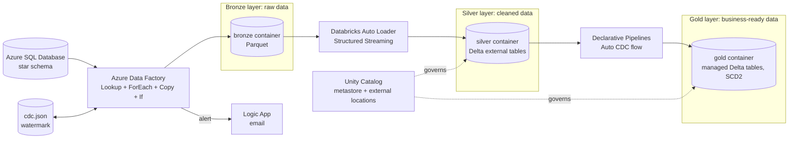

| Layer | Storage | Format | Built with | Purpose |
|---|---|---|---|---|
| 🥉 **Bronze** | ADLS Gen2 `bronze` container | Parquet | Azure Data Factory | Raw data copied incrementally from the source |
| 🥈 **Silver** | ADLS Gen2 `silver` container | Delta (external tables) | Databricks Auto Loader (PySpark) | Cleaned, deduplicated and enriched data |
| 🥇 **Gold** | ADLS Gen2 `gold` container | Delta (managed tables) | Lakeflow Spark Declarative Pipelines | History-tracked dimension tables |

---

## 🧰 Tech Stack

| Area | Technology |
|---|---|
| Source | Azure SQL Database (serverless, free offer) |
| Orchestration | Azure Data Factory (Lookup, ForEach, Copy, If Condition, Script, Delete, Web) |
| Alerting | Azure Logic Apps (Consumption) |
| Storage | Azure Data Lake Storage Gen2 (hierarchical namespace) |
| Processing | Azure Databricks (serverless), PySpark, Spark Structured Streaming, Auto Loader |
| Governance | Unity Catalog (metastore, catalog, schemas, storage credential, external locations) |
| Gold pipelines | Lakeflow Spark Declarative Pipelines (`dlt`) |
| DevOps | GitHub (ADF Git integration with feature branch and pull request), Declarative Automation Bundles |
| Languages | Python, SQL |

---

## 📊 Dataset

A star schema created by a SQL script in Azure SQL Database. The script inserts the sample rows (2,865 rows affected in total).

| Table | Type | Description |
|---|---|---|
| `FactStream` | Fact | Individual stream events (user, track, date, listen duration, device, timestamp) |
| `DimUser` | Dimension | Listener details (name, country, subscription type, dates) |
| `DimTrack` | Dimension | Track details (name, artist, album, duration, release date) |
| `DimArtist` | Dimension | Artist details |
| `DimDate` | Dimension | Calendar attributes |

The script ran successfully and created the five tables of the star schema.

**Figure 1: Source database script**

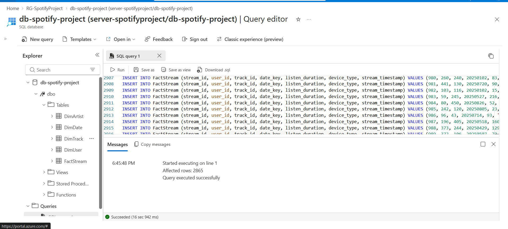

---

## 🛠️ Implementation Walkthrough

### 1. Azure environment setup

One resource group holds all project resources: Data Factory, SQL server and database, storage account, Databricks workspace, access connector and Logic App.

**Figure 2: Resource group**

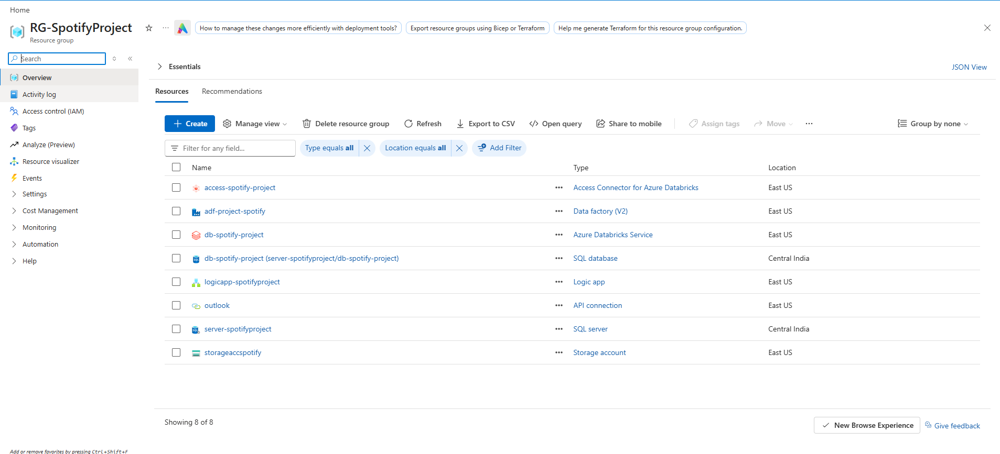

The storage layer is one **ADLS Gen2** account with `bronze`, `silver`, `gold` and a container for the Unity Catalog metastore.

**Figure 3: Data Lake containers**

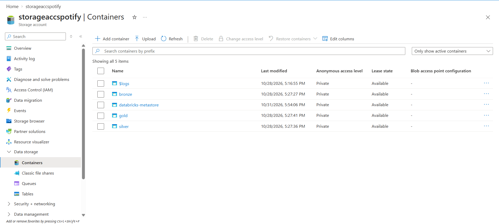

### 2. Incremental ingestion with Azure Data Factory (Bronze)

ADF reaches the source and the lake through two linked services, one for Azure SQL Database and one for the Data Lake.

**Figure 4: Linked services**

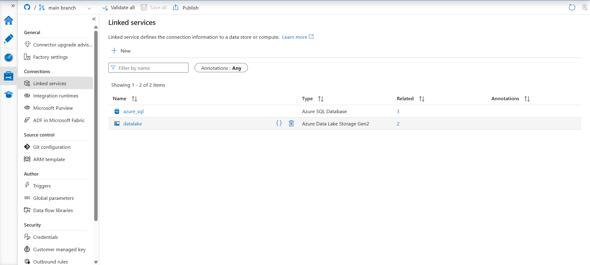

**The watermark.** A small JSON file, `cdc.json`, stores the latest timestamp that was loaded:

```json
{"cdc": "1900-01-01"}
```

On the first run the value is `1900-01-01`, so every row is copied.

**Figure 5: Watermark before the first run**

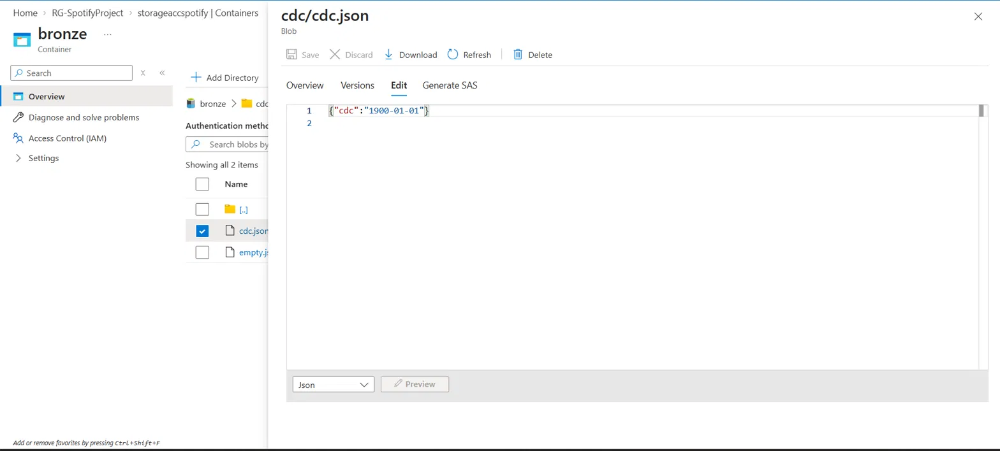

After each successful run, the file is updated with the newest timestamp that was copied.

**Figure 6: Watermark after a run**

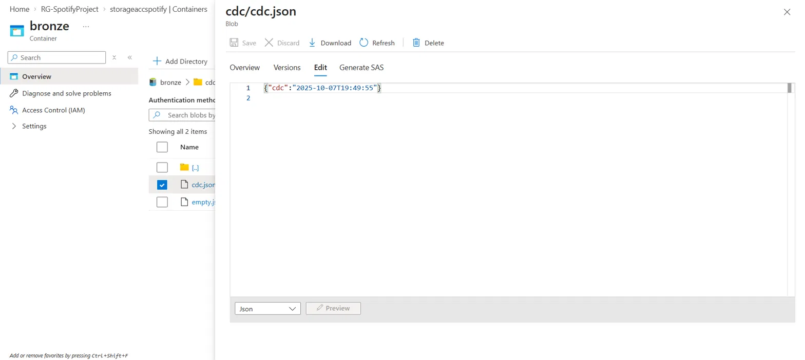

**Pipeline `incremental_ingestion`:**

| Step | Activity | Purpose |
|---|---|---|
| 1 | **Lookup** (`last_cdc`) | Reads the saved watermark from `cdc.json` |
| 2 | **Set variable** (`current`) | Builds a timestamp used in the output file name |
| 3 | **Copy data** (`AzureSQLtoLake`) | Copies only rows newer than the watermark, as Parquet into Bronze |
| 4 | **If Condition** | Checks whether any rows were copied |
| 4a | ✅ True: **Script** (`max_cdc`), then **Copy** (`update_last_cdc`) | Finds the newest timestamp and writes it back to `cdc.json` |
| 4b | ❌ False: **Delete** (`DeleteEmptyFile`) | Removes the empty file, so Bronze stays clean |

The source query is built from pipeline parameters (`schema`, `table`, `cdc_col`):

```sql
SELECT * FROM @{pipeline().parameters.schema}.@{pipeline().parameters.table}
WHERE @{pipeline().parameters.cdc_col} > '@{activity('last_cdc').output.value[0].cdc}'
```

Every activity succeeded on the first full load.

**Figure 7: First successful run**

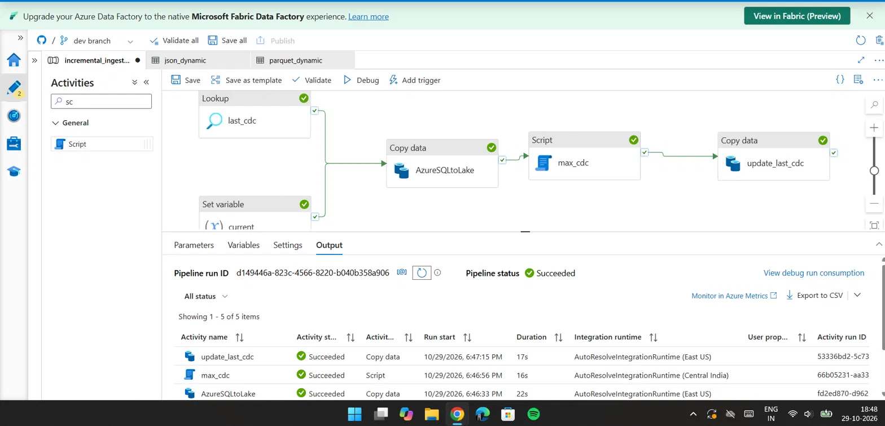

**Why the If Condition matters.** Before it existed, a run with no new data still wrote an empty file (0 rows read, 314 bytes written).

**Figure 8: A run with no new data, before the fix**

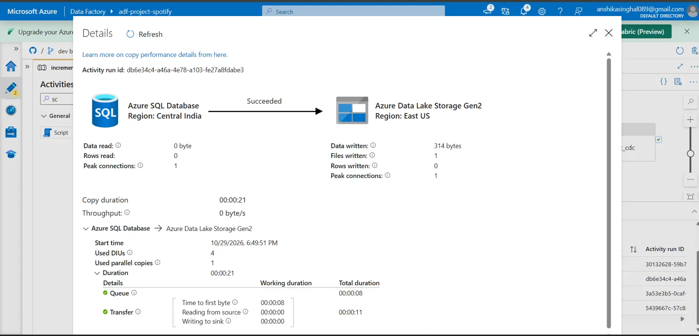

With the If Condition in place, the empty file is deleted and the watermark is left unchanged.

**Figure 9: If Condition, False branch**

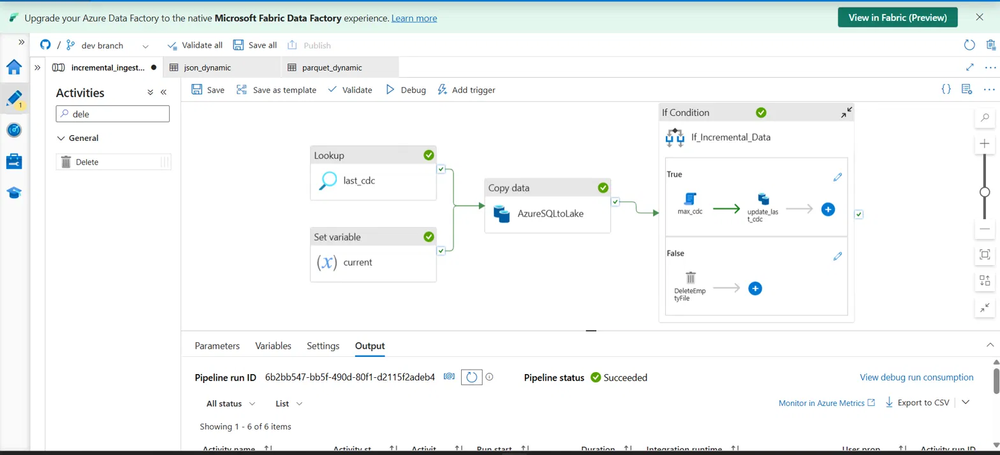

### 3. Metadata-driven loop and alerting

**Pipeline `incremental_loop`** takes an array of tables as a parameter and applies the incremental logic to each one in a **ForEach**. Adding a table means adding one entry to the array, with no new pipeline.

**Figure 10: Loop run**

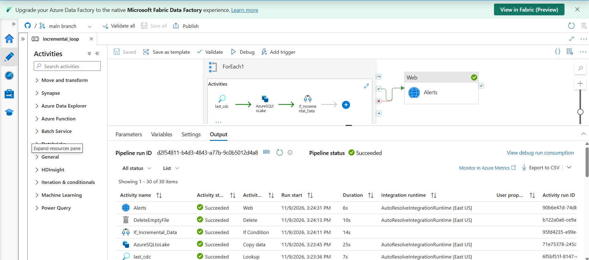

When the source has new rows, the loop copies exactly those rows. In this run, 2 rows were read and 2 written into one new file.

**Figure 11: Incremental copy details**

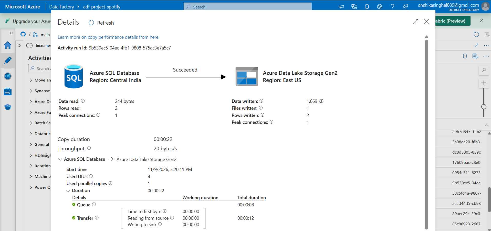

**Alerts.** A **Web** activity calls an Azure **Logic App** (HTTP trigger) that sends an email about the pipeline run. The workflow is an HTTP trigger followed by a send-email action. The trigger URL is a secret and is hidden.

**Figure 12: Logic App workflow**

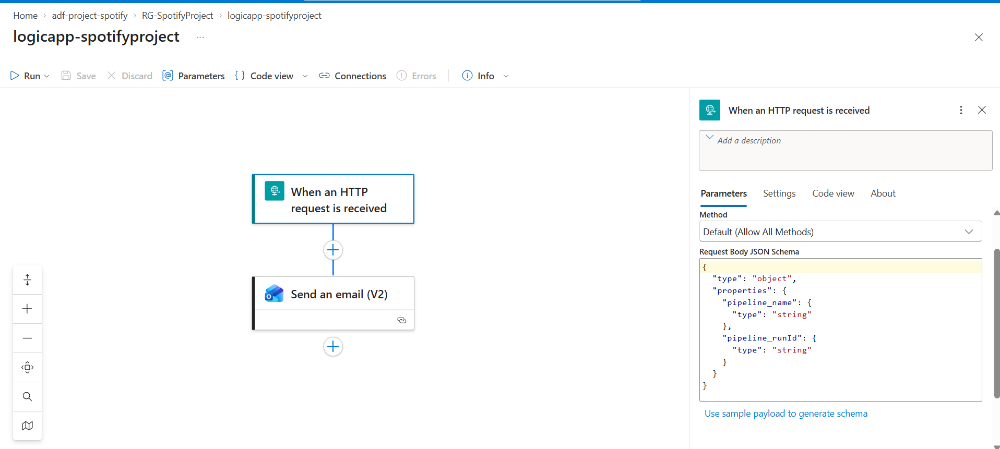

This is the email received after a run.

**Figure 13: Alert email**

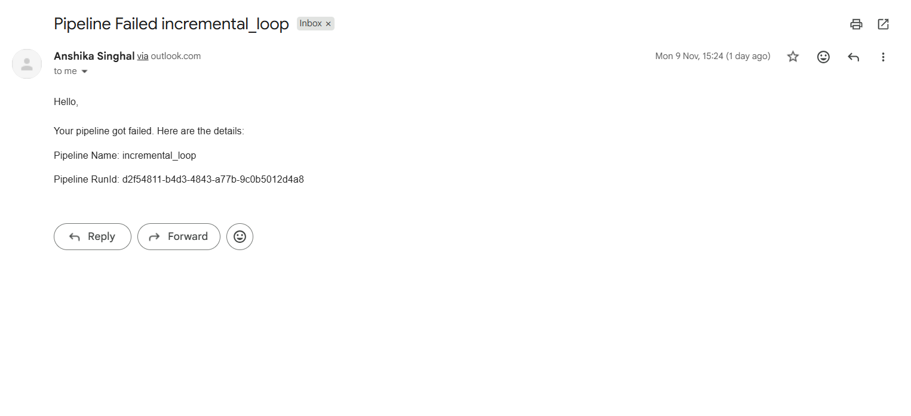

### 4. Governance with Unity Catalog

A Unity Catalog **metastore** is assigned to the Databricks workspace.

**Figure 14: Metastore**

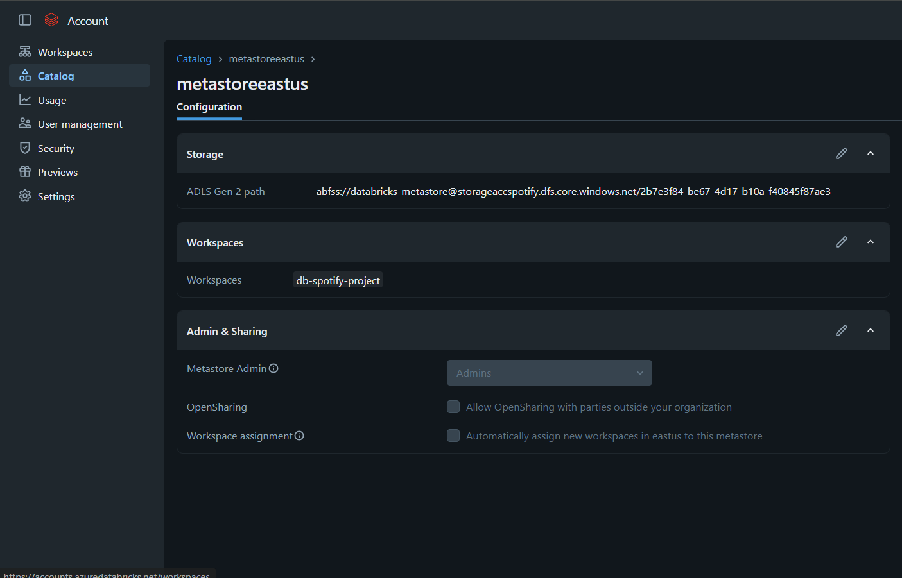

Storage access uses an **access connector** (managed identity) with the *Storage Blob Data Contributor* role on the storage account. A **storage credential** and **external locations** are defined for `bronze`, `silver` and `gold`.

**Figure 15: External locations**

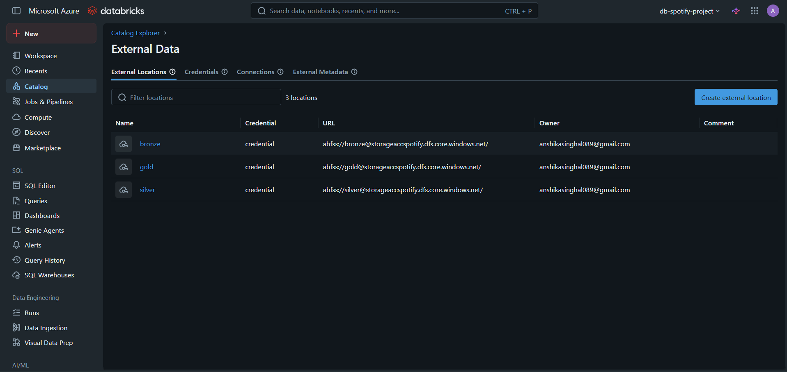

A catalog `spotify_catalog` holds the `silver` and `gold` schemas.

### 5. Silver layer with Auto Loader

Each table is read as a stream with Auto Loader, transformed, and written to a Delta table in the silver container.

```python
df_user = (spark.readStream.format("cloudFiles")
    .option("cloudFiles.format", "parquet")
    .option("cloudFiles.schemaLocation", f"{silver}/DimUser/schema")
    .option("cloudFiles.schemaEvolutionMode", "addNewColumns")
    .load(f"{bronze}/DimUser"))

df_user = df_user.withColumn("user_name", upper(col("user_name")))
df_user = reusable().dropColumns(df_user, ["_rescued_data"])
df_user = df_user.dropDuplicates(["user_id"])

(df_user.writeStream.format("delta")
    .outputMode("append")
    .option("checkpointLocation", f"{silver}/DimUser/checkpoint")
    .option("path", f"{silver}/DimUser/data")
    .trigger(availableNow=True)
    .toTable("spotify_catalog.silver.DimUser"))
```

This is the stream's transformed output for DimUser, with upper-cased names.

**Figure 16: Auto Loader output**

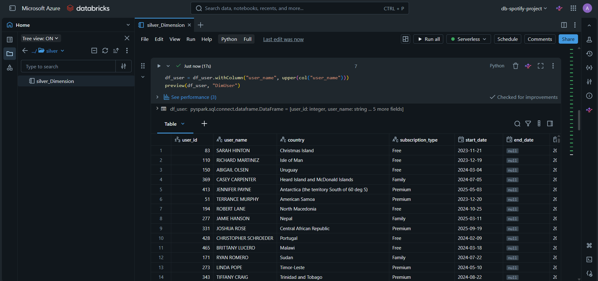

**Transformations per table**

| Table | Transformation | Purpose |
|---|---|---|
| DimUser | Upper-case `user_name`, drop `_rescued_data`, deduplicate on `user_id` | Consistent names, one row per user |
| DimArtist | Drop `_rescued_data`, deduplicate on `artist_id` | One row per artist |
| DimTrack | `durationFlag` (low, medium, high from `duration_sec`), clean `track_name`, drop `_rescued_data` | Derived attribute and cleaner names |
| DimDate | Drop `_rescued_data` | Analysis-ready calendar |
| FactStream | Drop `_rescued_data` | Analysis-ready facts |

**Streaming concepts used**

| Concept | How it is used |
|---|---|
| **Auto Loader (`cloudFiles`)** | Picks up only new files from Bronze |
| **Checkpoint** | Records which files were processed, so reruns never duplicate data |
| **Schema evolution** | `addNewColumns`, with `_rescued_data` capturing data that does not fit the schema |
| **`availableNow` trigger** | Processes all pending files, then stops, so compute runs only while needed |
| **External tables** | Silver tables point at the silver container through the `path` option |

After loading, these are the row counts for the silver tables.

**Figure 17: Silver row counts**

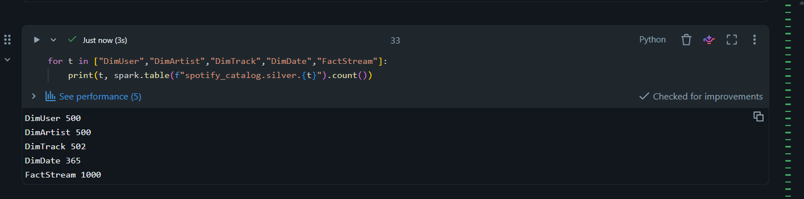

### 6. Gold layer with Declarative Pipelines (SCD Type 2)

Each dimension has a staging streaming table and a target table that applies changes with `create_auto_cdc_flow`, keeping the history of every change. Staging tables carry data-quality expectations.

```python
import dlt

@dlt.table
def dimtrack_stg():
    return spark.readStream.table("spotify_catalog.silver.dimtrack")

dlt.create_streaming_table("dimtrack")

dlt.create_auto_cdc_flow(
    target = "dimtrack",
    source = "dimtrack_stg",
    keys = ["track_id"],
    sequence_by = "updated_at",
    stored_as_scd_type = 2
)
```

A completed run shows the staging tables feeding their target tables, with row counts and no errors.

**Figure 18: Pipeline graph**

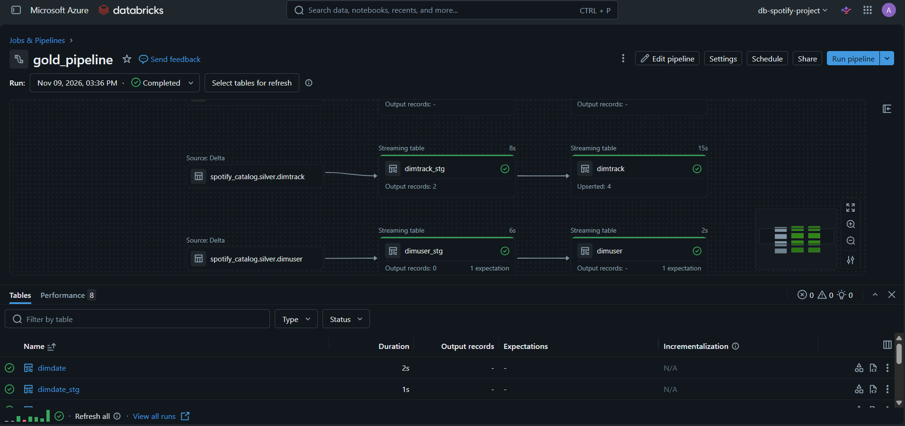

The SCD2 result is visible in the data. The same `track_id` appears more than once, and `__START_AT` shows when each version became valid.

**Figure 19: DimTrack history**

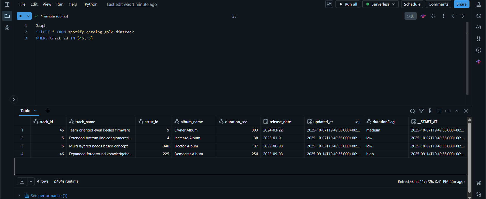

The gold DimUser table carries the same history columns.

**Figure 20: DimUser history**

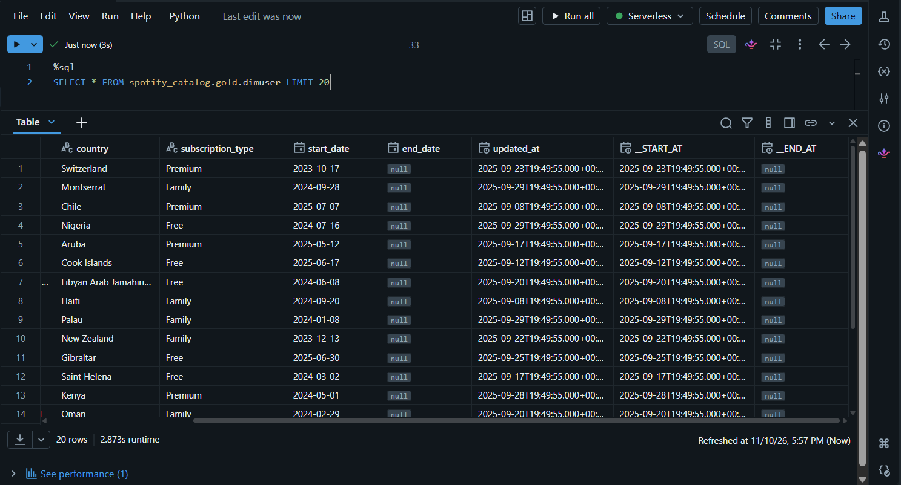

All silver and gold tables are registered in Unity Catalog.

**Figure 21: Catalog explorer**

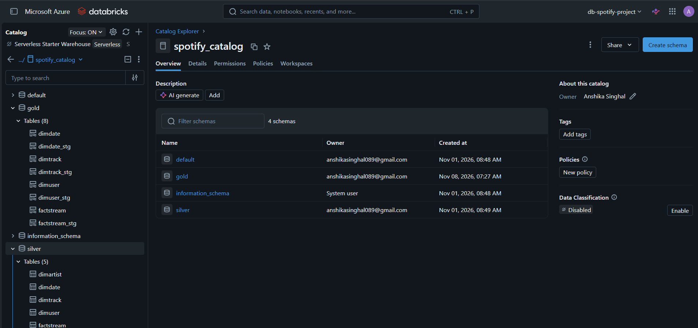

### 7. Declarative Automation Bundle

The project was scaffolded with Declarative Automation Bundles (formerly Databricks Asset Bundles) and deployed to **dev** and **prod** targets.

```bash
databricks bundle deploy --target dev
databricks bundle deploy --target prod
```

The deploy uploads the project files to separate paths for each target. The silver notebook and gold pipeline were built and run directly in the workspace.

**Figure 22: Bundle deployment**

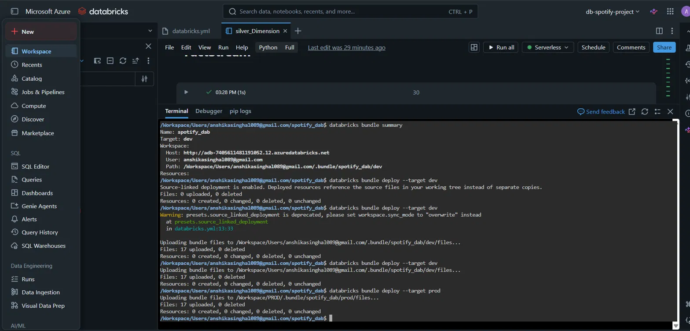

**Figure 23: Bundle folder**

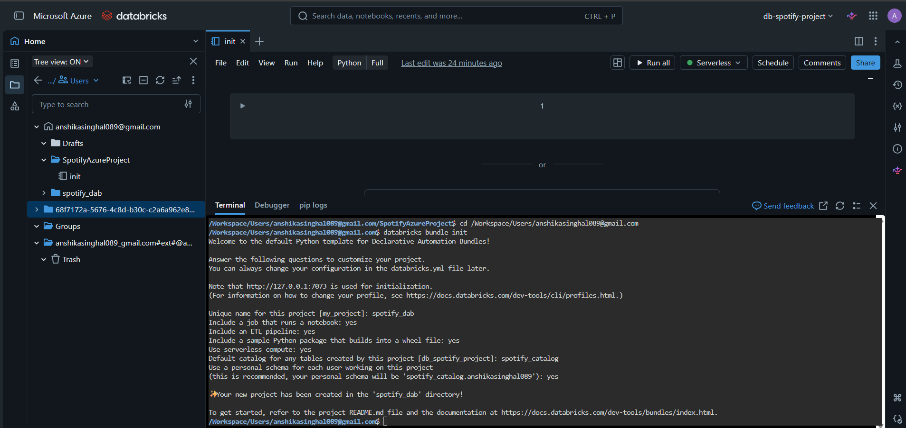

---

## 🚀 How to Reproduce

> **Prerequisites:** an Azure subscription (the free trial is enough), a Databricks workspace with Unity Catalog enabled, a GitHub account, and the Databricks CLI for the bundle step.

1. **Source database:** create an Azure SQL Database (free offer) and run the script in `source_script/` to create and load the five star-schema tables.
2. **Storage:** create an ADLS Gen2 account with the `bronze`, `silver`, `gold` and metastore containers.
3. **Watermark:** upload `adf_support/cdc.json` (`{"cdc": "1900-01-01"}`) and the `empty.json` template to the storage account.
4. **Data Factory:** connect ADF to this repository, create linked services for Azure SQL and the Data Lake, and import the `incremental_ingestion` and `incremental_loop` pipelines.
5. **Alerting (optional):** create a Consumption Logic App with an HTTP trigger and a send-email action, then point the Web activity at its URL. Keep the URL secret.
6. **Governance:** create the Unity Catalog metastore, an access connector with *Storage Blob Data Contributor* on the storage account, a storage credential, and external locations for `bronze`, `silver` and `gold`. Create the catalog `spotify_catalog` with `silver` and `gold` schemas.
7. **Run ingestion:** run `incremental_loop` in ADF. Data lands in the `bronze` container.
8. **Silver:** run the notebook in `databricks/notebooks/` to stream Bronze into the silver Delta tables.
9. **Gold:** create a pipeline from `databricks/gold_pipeline/` and run it to build the SCD2 tables.
10. **Test incremental loading:** insert or update rows in the source, then rerun. Only the new rows are copied, and changed dimension rows get a new version in Gold.
11. **Clean up:** delete the resource group when finished to stop all charges.

---

## 📁 Repository Structure

```
├── dataset/              # ADF datasets (managed by ADF Git integration)
├── factory/              # ADF factory definition
├── linkedService/        # ADF linked services
├── pipeline/             # ADF pipelines (incremental_ingestion, incremental_loop)
├── publish_config.json   # ADF publish settings
├── adf_support/          # cdc.json (watermark), empty.json (template), loop input
├── source_script/        # SQL scripts that create and load the source database
├── databricks/
│   ├── notebooks/        # Silver layer notebook (Auto Loader)
│   ├── gold_pipeline/    # Declarative pipeline code (staging + Auto CDC)
│   └── spotify_dab/      # Declarative Automation Bundle (dev and prod targets)
├── images/               # Screenshots of every stage
└── README.md
```

---

## 🧠 Key Concepts Demonstrated

| Concept | Where it appears |
|---|---|
| Medallion architecture | Bronze, Silver and Gold containers |
| Incremental loading with a watermark | `cdc.json`, Lookup, parameterized query, If Condition |
| Metadata-driven pipelines | ForEach loop over an array of tables |
| Idempotent, resumable streaming | Auto Loader checkpoints and `availableNow` triggers |
| Schema evolution | `addNewColumns` and `_rescued_data` |
| Data governance | Unity Catalog metastore, storage credential and external locations |
| Managed identity access | Access connector with a Storage Blob Data Contributor role |
| SCD Type 2 | `create_auto_cdc_flow` with `__START_AT` and `__END_AT` |
| Data quality | Expectations on staging tables |
| Alerting | Logic App email triggered from ADF |
| Git workflow | ADF feature branch, pull request and `main` |
| Infrastructure as code | Declarative Automation Bundle with dev and prod targets |
| Cost control | Serverless compute, free-tier SQL with auto-pause, `availableNow` |

---

## 🐞 Engineering Challenges and Resolutions

A large part of the learning came from debugging real failures. The run history below spans several weeks and shows the early failures and the fixes that followed.

**Figure 24: ADF pipeline run history**

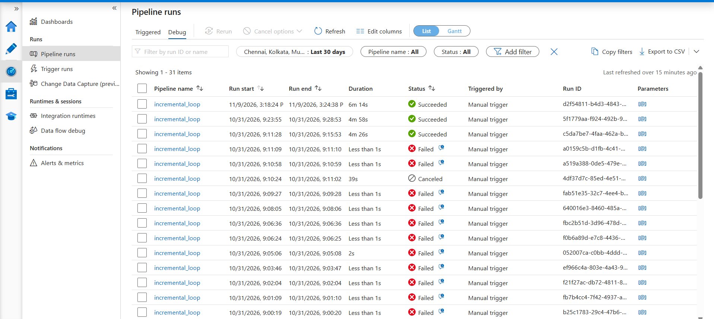

The most instructive problems:

| Challenge | Root cause | Resolution |
|---|---|---|
| **SQL syntax error near `User` in the Copy activity** | `USER` is a reserved word in SQL, and the pipeline parameters still held old defaults (`User`, `updated_at`) | Set the parameters to the real table and column names, and wrapped reserved names in brackets |
| **Watermark update failed with `PathNotFound`** | The template file `empty.json`, which the update step reads, had been deleted | Restored the file and checked that the delete step targets the correct folder |
| **Pipeline run rejected with `BadRequest` and no message** | A problem in the pipeline definition after adding the alert | Compared versions in GitHub history, restored a good version of the pipeline JSON and re-added the alert step |
| **Azure SQL "not currently available" errors** | The serverless database auto-paused when idle | Retried after the database resumed, and added retries to the Copy activity |
| **Database connection blocked by the firewall** | The client IP address changed | Added the new IP to the server firewall, while ADF connects through the "Allow Azure services" setting |
| **SQL server could not be created in the first region** | The region was not accepting new SQL servers for the subscription | Created the server in another region |
| **Metastore creation failed three times** | Missing `abfss://` scheme, then a typo (`abfs`), then the access connector's managed identity could not be found | Corrected the path, then resolved the identity lookup by opening the account console from the Azure workspace |
| **Databricks reported invalid credentials** | A typo in the storage account name, so the path matched no external location and Spark looked for an account key | Fixed the path, using variables so the name is defined once |
| **`display()` on a stream showed only progress** | Streaming `display` on serverless compute does not render a table | Wrote the stream to a preview folder and displayed it as a batch |
| **Pipeline failed with `DAC_DOES_NOT_EXIST`** | The metastore had no root storage credential, so managed tables had nowhere to go | Gave the gold schema its own managed location, and used external tables with an explicit `path` in silver |
| **`LOCATION_OVERLAP` when creating a table** | An earlier test table already used the same storage path | Dropped the old table and cleared its folder before rerunning |
| **Duplicate table error in the gold pipeline** | A staging table was defined in two files, and every table name must be unique across the pipeline | Removed the duplicate definition |

---

## 🔒 Security Practices

- No passwords, keys or tokens are committed. Workspace URLs and emails in the bundle files are replaced with placeholders.
- ADF does not store linked-service credentials in Git.
- The Logic App trigger URL, which works like a password, is not published.
- Databricks reaches storage through an **access connector** (managed identity) and Unity Catalog external locations, not account keys.

---

## 💰 Cost Management

- Serverless Databricks compute, with streams that use the `availableNow` trigger and stop when the work is done.
- Azure SQL Database on the **free offer**, with auto-pause when the monthly limit is reached, so it cannot be billed.
- A Consumption Logic App, billed only per run.
- Resource group deleted after the project was documented, to stop all charges.

Spend by service for the project's resource group was covered by the free trial credit.

**Figure 25: Cost analysis**

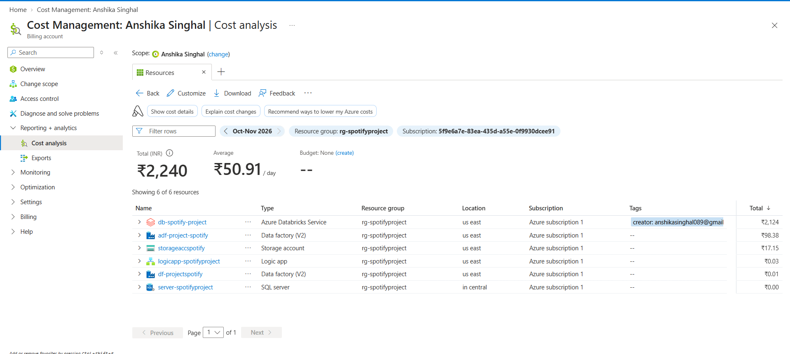

---

## 🔭 Next Steps

- Store secrets in **Azure Key Vault**, and use a managed identity instead of an account key for the ADF Data Lake connection.
- Trigger the Databricks notebook and gold pipeline from ADF, and add a schedule trigger for end-to-end orchestration.
- Define the gold pipeline as a bundle resource, so `bundle deploy` creates it for each environment.
- Add CI/CD for ADF (automated publish) and for the bundle.
- Fix the metastore root credential so managed tables work without per-schema locations.
- Build a Power BI report on the gold tables.